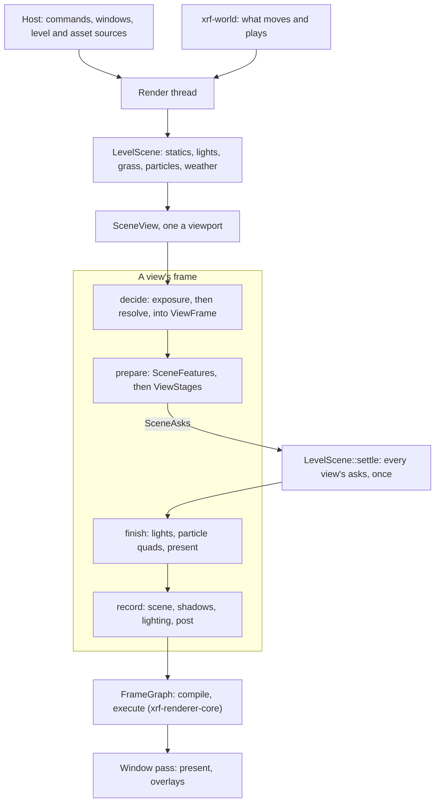

# xrf-renderer

The native renderer: one GPU and one render thread drawing viewports into the application's windows.

Every viewer in the desktop app draws through it, under a transparent webview: the level viewer, the mesh viewers and
the texture view.

- It is built on wgpu and on [xrf-renderer-core](../xrf-renderer-core/README.md)'s frame graph.
- What moves and plays in a level comes from [xrf-world](../xrf-world/README.md).
- DLSS comes from [xrf-dlss](../xrf-dlss/README.md).

## What the host provides

The renderer takes what it draws in memory and never opens a file. It knows its host only through these traits, which
the app implements:

| Trait               | What the host gives                                                                        |
| ------------------- | ------------------------------------------------------------------------------------------ |
| `RenderLevelSource` | An open level as a scene draws it: its sector count and shader table's surfaces            |
| `RenderAssetSource` | Texture bytes by reference, within a scope two sources share when they read the same files |
| `RenderWindowHost`  | A native window to draw into: its surface target, client size, and whether it is hidden    |
| `RenderEventSink`   | Where one viewport's `RenderViewportEvent`s go; in the app, the channel its page attached  |
| `RenderWorld`       | What moves and plays, run on the render thread before each frame (`xrf-world`'s `World`)   |
| `RenderCacheStore`  | Bytes kept between runs: the driver's compiled pipelines                                   |
| `RenderBundle`      | The files the renderer ships beside its code, under `assets/` (`RENDER_BUNDLE_SOURCE`)     |
| `RenderWorkers`     | The application's thread pool, which every loader reads and decodes on                     |

`RenderWindowHost` is an `unsafe trait`. The surface target it returns must name a live window (or a layer drawn in
one) until every viewport attached with it is detached and the render thread has handled that detach
(`RenderQueue::wait_handled` returns anything but a timeout). The renderer presents into it until then.

Level content (packed sectors, lights, spawns, grass, particles, weather) is read by the host through `xrf-world`'s
`WorldLevelSource`, which extends `RenderLevelSource`, and handed over each frame.

## The render thread

`RenderQueue::new(workers, bundle, world)` is the entry point. It is cheap and touches no GPU until a viewport is
attached.

- Every `RenderCommand` is a message to the render thread, the only thread touching the GPU. Clones reach the same
  thread.
- The first `Attach` starts the thread; it stops a few seconds after the last detach. A tool that never draws never
  starts a GPU.
- With no thread running, any command other than an attach does nothing, but `Settings` are kept for the next thread.

Commands:

- `Attach` gives a viewport its id, window host and event sink. `Layout`, `Options`, `Overlays` and `Selection` steer
  it.
- `Pick`, `Describe*`, `Capture`, `Screenshot`, `CaptureMap` and `CaptureCube` answer on a channel. `Pick`, `Capture`
  and `Screenshot` answer after the viewport's next frame, and never for a viewport that is not drawn, so wait with a
  timeout.
- `wait_handled(wait)` waits until every earlier command is handled; `stop(wait)` detaches every viewport and waits
  until the GPU is released.
- `with_cache_store` keeps the driver's compiled pipelines between runs.

### Backends

`RenderBackend` is D3D12 or Vulkan where the platform builds them, tried in that order when the requested one cannot
start, and Metal alone on Apple platforms (experimental: no CI job builds or tests it).

`XRF_RENDER_BACKEND` overrides the settings' choice. [ENVIRONMENT.md](../../ENVIRONMENT.md) lists it with wgpu's own
switches, which the renderer honours.

## A frame

A scene (`LevelScene`) holds a level's content and is shared by every view of it. Each viewport draws the scene through
a view (`SceneView`), once per frame:

1. **Decide.** The view prepares its exposure and temporal resolve first, and stores what the resolve decided (the
   noise frame, whether DLSS reconstructs rays) in `ViewFrame`, which every other unit reads.
2. **Prepare.** Every unit sets up its frame from its settings, the scene, the weather and `ViewFrame`. The view reports
   what it needs from the scene (`SceneAsks`: the lights it sees).
3. **Settle.** Once every view of a scene has prepared, the scene settles all their asks at once: the shadow faces each
   view wants, the driving view's casters, and the joined particle step.
4. **Finish.** Each view writes its lights, fills its particle quads and readies its present from the settled scene.
5. **Record.** The view declares its passes into the frame graph in running order: scene into the G-buffer, shadows,
   lighting, then what is laid over the lit frame and the resolve. The resolve returns an `ImageChain`, the image later
   layers are drawn over.

The window pass then presents each view's image.

### How the code is organised

A view's units are grouped by how much of the frame they draw in:

- Units that record in several phases, or are read by every phase, are view-level (`SceneFeatures`).
- Units drawing in one part of the frame belong to that part's stage, private from the other stages.

Their passes are built once for every view and grouped the same way; each holds its pipelines in a `PipelineSet`.

| Location               | Holds                                                                                           |
| ---------------------- | ----------------------------------------------------------------------------------------------- |
| `src/feature/<group>/` | One group of passes: `scene`, `lighting`, `tracing`, `weather`, `effects`, `image`              |
| `<group>_passes.rs`    | The group's passes                                                                              |
| `<group>_stage.rs`     | The group's stage, where it has one                                                             |
| `<group>/<feature>/`   | One feature (such as `image/bloom/`): unit, passes, parameters, uniforms, the types it produces |
| `src/pass/`            | What no single feature produces: the view binding, the pipeline source, the lighting uniform    |
| `src/scene/level/`     | The scene's own state and its views                                                             |

### Where a feature plugs in

**An effect drawn in one part of the frame**, such as a post effect after the resolve:

1. Add its folder under its group (`feature/image/<name>/`: unit, pass, parameters, uniform) and its shader under
   `shaders/`.
2. Add the pass to the group's passes: a field, a build line and a refresh line, plus its parameters and uniform in
   `declare_shaders`.
3. Add the unit to the stage: a field, a `prepare` line, a record line (after the resolve, in
   `ImageStage::add_over_resolved`), and a `view_units!` entry.
4. A pass after the resolve that deliberately reads a drawn target tags the read (`JitterGuard::READS_*`), with the
   reason beside the tag.
5. Put the setting in `contract/`, and an applied readout in the stage's `describe`.

**A feature recording in several phases:** a unit in `SceneFeatures`, called from the view's aspects
(`scene/level/view/scene_view/`) in frame order.

**New level data:** the host reads it through `xrf-world`'s `WorldLevelSource` and hands it over as a
`RenderSceneUpdate`, which `LevelScene` applies.

- A store a unit draws (statics, grass, lights) is read from the scene by that unit.
- A value any unit may read while readying a view (the clock, the gust, the wetness, what the view sees, placed
  volumes) joins `LevelPrepare` (`scene/level/level_prepare.rs`), which the view takes from the scene once per frame
  and passes to its units and stages.

**A new drawable kind** beside the static scene (grass is the one today, `feature/scene/grass/`): add a variant to each
enum that the all-kinds consumers dispatch through (`feature/scene/drawable/`).

- The scene group draws it into the G-buffer in phases: `DrawableKindSource` readies it before the static scene draws;
  `DrawableKindReadied` culls it against that depth, prepares its casters, and draws it before or after the reflections
  keep their depth.
- The sun's cascades and the lights' shadows take its casters as values (`PerFrameCasters`, `LightCasters`), drawn
  through `DrawableKindRef`. The view's ray-tracing top level takes its instances (`DrawableTraceInstance`). None of
  these know the kind.
- A kind that ray hits read has its own bindings in `TraceParameters` and the trace shaders.

**Another output**, such as HDR: the window's format and the present (`window/render_window.rs`,
`feature/image/present/`), whose pipelines are kept one set per format (`PipelineMap`).

## The contract

The `Render*` types under `src/contract/` cross IPC to the page: settings, view options, reports and events.

- Values the page uses for bounds or defaults are marked with
  `#[cfg_attr(feature = "typescript-bindings", xrf_ipc::constant)]` where declared ([xrf-ipc](../xrf-ipc/README.md)).
- After changing either, regenerate the frontend mirrors with `cargo make generate-typescript`.

## Shaders

The renderer's WGSL lives in `shaders/`.

- A module is named by its path under `shaders/`, without the extension; `#import` inlines another.
- An import needing a feature the device lacks is composed as its fallback (the scene trace without ray queries).
- Every file under `shaders/` is embedded (listed by `build.rs`), so adding a module is just adding its file.
- A debug build also reads them from the checkout and watches them, so an edit shows on the next reload.

`shaders/generated/` is written from Rust:

- the structs shaders share with Rust (`ShaderStruct`);
- each module's bindings, gathered from the parameters of every pass drawing with it (`PassParameters`).

Each group of passes declares the structs and modules its passes use (`declare_shaders`). The test
`every_generated_module_is_up_to_date` rewrites a stale file and fails once; commit the rewritten file.

## Features

| Feature               | Effect                                                                                    |
| --------------------- | ----------------------------------------------------------------------------------------- |
| `dlss`                | Upscales with NVIDIA DLSS on Vulkan and D3D12, built against its SDK (`xrf-dlss/sdk`)     |
| `tracy`               | Zones, GPU zones and frame marks for a Tracy capture (`xrf-renderer-core/tracy`)          |
| `typescript-bindings` | Derives the contract's Specta types and registers its constants for the generated mirrors |

The renderer adapts third-party work, AMD FSR among it; [THIRD_PARTY_NOTICES.md](THIRD_PARTY_NOTICES.md) holds their
credits.

## Checks

Run `cargo test --locked -p xrf-renderer`. Tests that draw open a device through `src/tests/support/test_context.rs`;
they skip with a message on a machine without one, or fail where `XRF_TEST_REQUIRE_GPU` is set.

Sources: the [host traits](src/host/), the [queue](src/thread/queue/render_queue.rs) and
[commands](src/thread/queue/render_command.rs), the [contract](src/contract/), and the
[shader library](src/shader/shader_library.rs).
