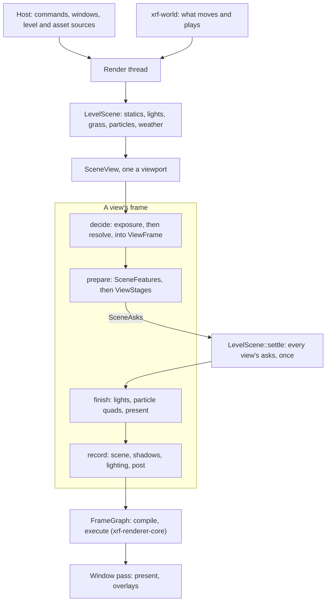

# xrf-renderer

The native renderer: one GPU and one render thread drawing viewports into the application's windows. Every viewer of
the desktop app draws through it, under a transparent webview: the level viewer, the mesh viewers and the texture body.
It is built on wgpu and on [xrf-renderer-core](../xrf-renderer-core/README.md)'s frame graph; what moves and plays in a
level comes from [xrf-world](../xrf-world/README.md), and DLSS from [xrf-dlss](../xrf-dlss/README.md).

## What the host provides

The renderer takes what it draws in memory and never opens a file. It knows the application hosting it only through
these traits, which the app implements:

| Trait               | What the host gives                                                                        |
| ------------------- | ------------------------------------------------------------------------------------------ |
| `RenderLevelSource` | An open level as a scene draws it: its sector count and shader table's surfaces            |
| `RenderAssetSource` | Texture bytes by reference, within a scope two sources share when they read the same files |
| `RenderWindowHost`  | A native window to draw into: its surface target, client size, and whether it is hidden    |
| `RenderEventSink`   | Where one viewport's `RenderViewportEvent`s go: in the app, the channel its page attached  |
| `RenderWorld`       | What moves and plays, run on the render thread before each frame (`xrf-world`'s `World`)   |
| `RenderCacheStore`  | Bytes kept between runs: the driver's compiled pipelines                                   |
| `RenderBundle`      | The files the renderer ships beside its code, under `assets/` (`RENDER_BUNDLE_SOURCE`)     |
| `RenderWorkers`     | The application's own thread pool, which every loader reads and decodes on                 |

`RenderWindowHost` is an `unsafe trait`: the surface target it answers must name a live window, or a layer drawn in
one, until every viewport attached with it is detached and the render thread has handled that detach
(`RenderQueue::wait_handled` answering anything but a timeout). The renderer presents into it until then.
What a scene takes in (packed sectors, lights, spawn, grass, particles, the level's weather) the host reads through
`xrf-world`'s `WorldLevelSource`, which extends `RenderLevelSource`, and hands over each frame.

## The render thread

`RenderQueue::new(workers, bundle, world)` is the way in: cheap to make, and touching no GPU until a viewport is
attached. Every `RenderCommand` sent is a message to the render thread, the only one touching the GPU. The thread is
started by the first `Attach` and stopped a few seconds after the last detach, so a tool that never draws never starts
a GPU; a command other than an attach with no thread running does nothing, but `Settings` are kept for the next
thread. A clone reaches the same thread.

- `Attach` gives a viewport its id, window host and event sink; `Layout`, `Options`, `Overlays` and `Selection` steer
  it; `Pick`, `Describe*`, `Capture`, `Screenshot`, `CaptureMap` and `CaptureCube` answer on a channel. `Pick`,
  `Capture` and `Screenshot` answer after the viewport's next frame and never for a viewport the renderer does not
  draw, so wait on them with a timeout.
- `wait_handled(wait)` waits until every command sent before is handled; `stop(wait)` detaches every viewport and waits
  until the GPU is let go.
- `with_cache_store` keeps the driver's compiled pipelines between runs.

The backend is a `RenderBackend`: D3D12 and Vulkan where the platform builds them, tried in that order when the one
asked for cannot start, and Metal alone on Apple platforms (experimental: no CI job builds or tests it).
`XRF_RENDER_BACKEND` overrides the settings' choice; [ENVIRONMENT.md](../../ENVIRONMENT.md) lists it and wgpu's
switches, which the renderer reads as its own.

## A frame

A scene (`LevelScene`) holds a level's content and is shared by every view of it. Each viewport draws the scene
through a view (`SceneView`), once a frame:

1. **Decide.** The view prepares its exposure and its temporal resolve first and stores what the resolve decided for
   the frame (the noise frame, whether DLSS reconstructs rays) in `ViewFrame`, which every other unit reads.
2. **Prepare.** Every unit takes its frame from its settings, the scene, the weather and `ViewFrame`, and the view
   answers what it asks of the scene (`SceneAsks`: the lights it sees).
3. **Settle.** Once every view of a scene has prepared, the scene settles their asks at once: the lights' shadow faces
   every view wants, the scene's driving view's casters casting, and the particles' step joined.
4. **Finish.** Each view writes its lights, fills its particle quads and readies its present from the settled scene.
5. **Record.** The view declares its passes into the core's frame graph in the order they run: the scene into the
   G-buffer, the shadows, the lighting, then what is laid over the lit frame and the resolve. The resolve answers an
   `ImageChain`, the image the layers after it are laid over.

The window pass then presents each view's image. A view's units are split by how much of the frame they draw in. Those
recording in several phases, or read by every phase, are view-level (`SceneFeatures`). Those drawing in one part of the
frame alone belong to that part's stage, which keeps them private from the other stages. The passes they record with
are built once for every view and grouped the same way; each pass holds its pipelines in a `PipelineSet`.

The features live in `src/feature/`, one folder a group of passes (`scene`, `lighting`, `tracing`, `weather`,
`effects`, `image`). A group holds its passes (`image_passes.rs`), its stage where it has one (`image_stage.rs`) and a
folder a feature (`image/bloom/`) with its unit, passes, parameters, uniforms and the types it produces, whoever reads
them. What no one feature produces, such as the view binding, the pipeline source and the lighting uniform the frame
assembles, is in `src/pass/`; the scene's own state and its views are in `src/scene/level/`.

### Where a feature plugs in

- **An effect drawn in one part of the frame**, such as a post effect after the resolve: add its folder under its
  group (`feature/image/<name>/`: its unit, pass, parameters and uniform) and its shader under `shaders/`. Add the pass
  to the group's passes (a field, a build and a refresh line, and its parameters and uniform in `declare_shaders`),
  and the unit to its stage (a field, a `prepare` line, a
  record line, after the resolve in `ImageStage::add_over_resolved`, and a `view_units!` entry). A pass after the resolve that reads a drawn target on purpose tags the read
  (`JitterGuard::READS_*`), with the reason beside the tag. The setting goes in `contract/`; an applied readout goes in
  the stage's `describe`.
- **A feature recording in several phases**: a unit in `SceneFeatures`, called from the view's aspects
  (`scene/level/view/scene_view/`) in frame order.
- **New level data**: read by the host through `xrf-world`'s `WorldLevelSource`, handed over as a `RenderSceneUpdate`
  that `LevelScene` applies. A store a unit draws (statics, grass, lights) is read from the scene by that unit; a value
  every unit readying a view may read (the clock, the gust, the wetness, what the view sees, placed volumes) joins
  `LevelPrepare` (`scene/level/level_prepare.rs`), which the view takes from the scene once a frame and hands its
  units and stages.
- **A new drawable kind** beside the static scene, the grass being the one today (`feature/scene/grass/`): a variant
  of each enum the consumers drawing every kind alike dispatch through (`feature/scene/drawable/`). The scene group
  draws it into the G-buffer in its phases (`DrawableKindSource` readies it before the static scene draws,
  `DrawableKindReadied` culls it against their depth, stands its casters and draws it before or after the
  reflections keep their depth); the sun's cascades and the lights' shadows take its casters as values
  (`PerFrameCasters`, `LightCasters`) drawn through `DrawableKindRef`, and the view's own top level its instances
  (`DrawableTraceInstance`), knowing no kind. A kind a trace's hits read has its own bindings in `TraceParameters` and
  the trace's shaders.
- **Another output**, such as HDR: the window's format and the present (`window/render_window.rs`,
  `feature/image/present/`), whose pipelines are kept one set a format (`PipelineMap`).

## The contract

The `Render*` types under `src/contract/` cross IPC to the page: settings, view options, reports and events. Values the
page bounds or defaults by are marked with `#[cfg_attr(feature = "typescript-bindings", xrf_ipc::constant)]` where they
are declared ([xrf-ipc](../xrf-ipc/README.md)). After changing either, regenerate the frontend mirrors with
`cargo make generate-typescript`.

## Shaders

The renderer's WGSL lives in `shaders/`. A module is named by its path under `shaders/` without the extension, and
`#import` inlines another; an import needing a feature the device lacks is composed as its fallback (the scene trace
without ray queries). Every file under `shaders/` is embedded, listed by `build.rs`, so a new module is its file alone.
A debug build also reads them from the checkout and watches them, so an edited module is drawn with on the next
reload.

`shaders/generated/` is written from Rust: the structs shaders share with Rust (`ShaderStruct`), and each module's
bindings gathered from the parameters of every pass drawing with it (`PassParameters`). Each group of passes declares
the structs and modules its passes draw with (`declare_shaders`). The test
`every_generated_module_is_up_to_date` rewrites a stale file and fails once; commit the rewritten file.

## Features

| Feature               | Effect                                                                                    |
| --------------------- | ----------------------------------------------------------------------------------------- |
| `dlss`                | Upscales with NVIDIA DLSS on Vulkan and D3D12, built against its SDK (`xrf-dlss/sdk`)     |
| `tracy`               | Zones, GPU zones and frame marks for a Tracy capture (`xrf-renderer-core/tracy`)          |
| `typescript-bindings` | Derives the contract's Specta types and registers its constants for the generated mirrors |

The renderer adapts third-party work (AMD FSR among it); [THIRD_PARTY_NOTICES.md](THIRD_PARTY_NOTICES.md) is the one
place their credits live.

## Checks

Run `cargo test --locked -p xrf-renderer`. Tests that draw open a device through `src/tests/support/test_context.rs`, skipping
with a message on a machine with none, or failing where `XRF_TEST_REQUIRE_GPU` is set. Sources: the
[host traits](src/host/), the [queue](src/thread/queue/render_queue.rs) and [commands](src/thread/queue/render_command.rs), the
[contract](src/contract/), and the [shader library](src/shader/shader_library.rs).
